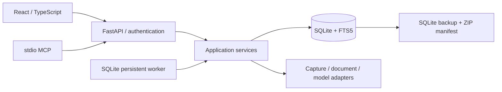

# 系统架构与运行约束

采用模块化单体，Web / MCP / Worker 共用服务层。

`apps/api/app/core.py` 管理 OS 数据目录与两种凭据；`db.py` 负责事务、WAL、外键、迁移基线和统一操作日志。`schemas.py` 定义 API 业务输入和模型输出。数据库约束位于 `migrations/001_initial.sql` 与 `002_minimal.sql`。

`services/cards.py` 维护原文、卡片视图、不可变快照、修订与检索；`services/imports.py` 组织采集 / 消息解析 / 问题引用 / 卡片保存；`adapters/` 处理外部结构。`services/knowledge.py` 保存文件并分块。`services/backup.py` 提供安全快照、验证与实际恢复。

API 生命周期启动一个 Worker 线程。任务首先事务写入 SQLite，再由 Worker 领取。异常持久化为 failed；中途关机留下的 running 任务在下次启动回到 queued。导入事务内写入，哈希幂等；整理以 job_id 判断已产生的候选修订，避免重启重复提交。检查结果按未处理卡片与类型去重。取消是协作式操作，已经提交的原始资料不会回滚或丢弃。

本地 `RLock` 将 SQLite 事务与恢复串行化，因此必须单 API 进程。网络模型调用在事务外运行，提交时再校验父版本。后续多进程应引入数据库租约 / CAS 领取与恢复互斥锁。

自动维护的下一次时间保存在 settings，错过的日程在应用启动后补跑。只有应用进程运行时才能执行任务；不创建系统守护进程，不声称电脑关机后仍会处理。

搜索优先命中原始用户问题，其次标题 / 摘要 / 正文。中文短查询用二元子串补充 FTS trigram，返回匹配问题及其 message_ids。此策略不是语义模型。真正的语义检索需启用独立 embedding adapter，向量模型 ID 与 revision_id 一起持久化，卡片更新后删除旧向量，RRF 合并关键词和向量候选。

备份包包含 SQLite 数据库与哈希清单。原始文件 BLOB 在 source_snapshots 中，因此无需单独同步附件文件夹。恢复验证格式、数据库版本、SHA-256、integrity_check、foreign_key_check 及逐条原始快照内容哈希。正式恢复前先备份当前数据。密钥不随数据库迁移。

V0.3 增加 `services/capture.py`（原始持久化 + 格式路由）、`services/enrichment.py`（规则/模型元信息、字段接管、自动调用配额、增量索引）和 `services/search.py`（可失败回退、缓存的语义补充）。旧 API 保持兼容。模型网络调用在事务外；提交时逐字段同时检查基础值和人工锁。索引只接受对应的当前 revision。前端 `minimal.tsx` 实现统一录入、回执、就地编辑与当前卡片资料候选；本地匹配保持顺序，语义只追加未出现的卡片。

自动模型作用范围为 human 从统一入口新建的记录及其后续语义索引更新，不借用人类范围处理 Agent 的提交；单独允许模型连接不等于开启自动处理。规则录入不依赖外部服务。预算默认每天 20 次自动请求、单次 16,000 字；失败也计入，超过限额保留本地结果。传统明确发起的正文整理/全库索引沿用显式调用入口，不属于这项自动配额。
