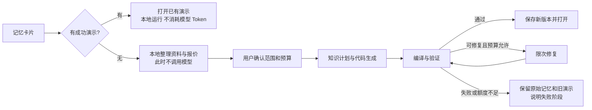
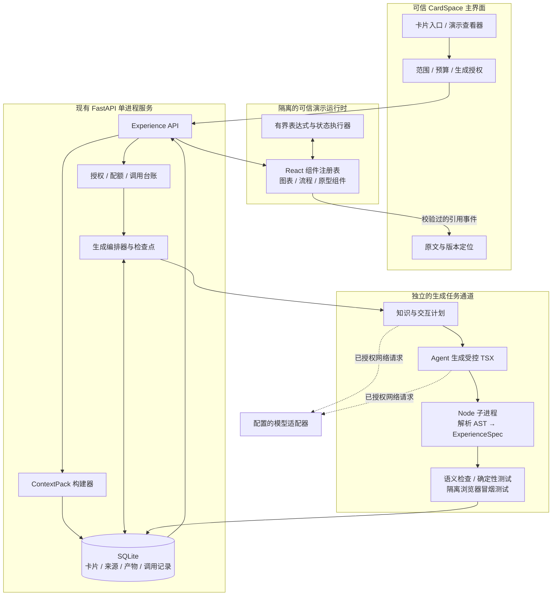
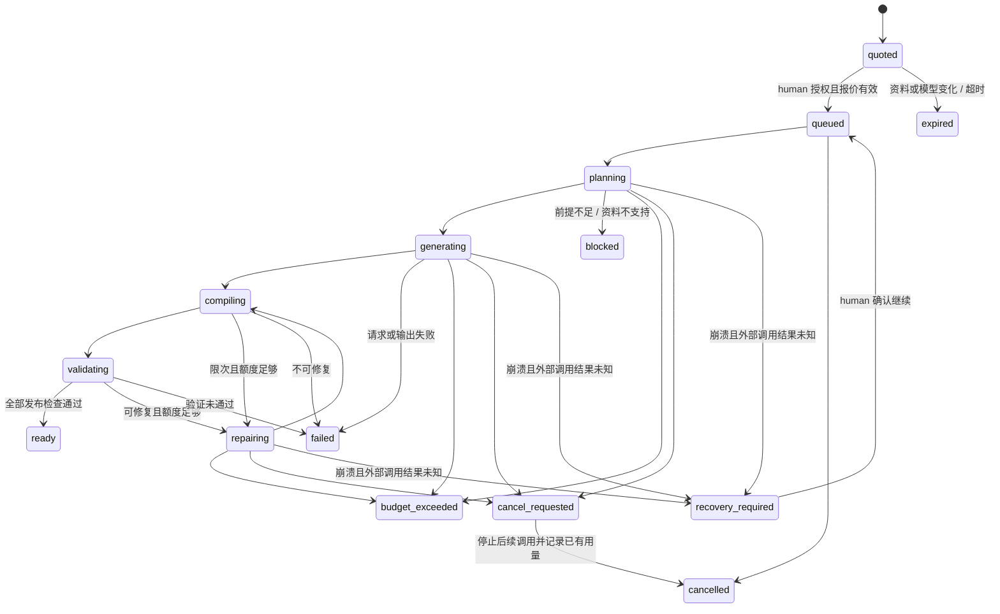

# CardSpace V0.4：交互演示实施蓝图

状态：实施前设计，尚未开发。日期：2026-10-23（Asia/Shanghai）。本文件是下一版本建议范围，不代表现有软件已具备这些能力。

## 1. 产品定义与本轮决策

将高密度记忆转为可操作的知识模型：用户改变参数、选择条件、推进步骤或尝试产品流程，界面立即展示相应变化，并能返回依据的原始问答。

推荐功能名为「交互演示」，内部对象名为 Experience。它是附属于记忆卡片的衍生产物，包含源代码、知识说明、交互模型、验证记录和版本。原始对话、当前卡片正文、证据状态与演示分别保存。

本轮确定以下方向，供实施 Agent 遵循：

1. 不录入即生成、不全库自动生成；每次付费生成、重新生成和修复必须有对应的用户授权范围。
2. 卡片旁常显一个「生成演示」入口；已有成功产物时显示「打开演示」。不依赖悬停，不要求填写长表单。
3. 源码驱动：Agent 写受控 TSX，编译器将其转为 ExperienceSpec；平台可信 React 运行时渲染。受控 TSX 是明确的语言子集，不宣称兼容任意 React 项目。
4. 首版只有参数实验、流程推演、产品交互原型三类核心能力；允许组合，不强制一张卡片套一个固定模板。
5. 交互操作采用本地确定性逻辑；拖动滑块、切换场景、推进步骤、重新打开已经生成的演示均不调用模型。
6. 采用原有 MIT 开源方向；源码可查看、导出和修改，协议、组件注册机制与样例公开。用户的私人记忆不因软件采用 MIT 就自动变成公开内容。
7. 先交付受控代码路线。任意 React/JavaScript 生成运行是后续独立能力，需要真实的执行隔离验证，不能作为首版隐藏后门。

## 2. 首版使用场景与边界

| 场景 | 用户实际操作 | 应当看到的变化 | 首版边界 |
|---|---|---|---|
| 新领域学习 | 改变参数、选择前提条件 | 图表、解释或结果随状态变化 | 可表达已知模型；未知关系不凭空补公式 |
| 流程理解 | 下一步、分支选择、查看节点 | 当前阶段、数据流、条件和输出变化 | 有限步骤和分支，保留对原文的定位 |
| 最小产品演示 | 输入样例、提交、切换页面/身份 | 本地样例状态、列表或流程变化 | UI 与业务流程原型；不是真实账户、支付或生产后端 |

例如：推荐系统卡片可演示「兴趣权重改变时候选内容排序如何变化」；订单卡片可演示「创建→校验→支付模拟→完成」；学习卡片可通过分支选择比较概念的适用条件。

模拟数字和简化公式必须标记为「教学示例」；引用了聊天回答不等于事实已核查。若源材料不足以建立互动关系，返回清楚的缺失条件，可提供范围更小的演示建议，不生成貌似完整的空白应用。

V0.4 暂不包括：任意 npm 安装、任意 JS 执行、互联网访问、真实后端接入、三维物理仿真、多人实时协作、云端自动发布、自动把演示输出写回记忆、视频导出。多卡联合生成预留协议，首版用户可见流程以单卡为主。

## 3. 用户交互图纸

### 3.1 卡片入口

```text
┌────────────────────────────────────────────┐
│ 推荐系统中的召回与排序                 ⋯    │
│ 一段简短摘要                               │
│                                            │
│ ChatGPT                      [生成演示 ◇]  │
└────────────────────────────────────────────┘
```

按钮必须在桌面、窄屏和键盘聚焦时都可发现；位于卡片标题/摘要之外，点击不误触「打开卡片」。详情页提供同一个功能入口，不额外增加全局导航。

| 产物状态 | 卡片旁按钮 | 点击行为 |
|---|---|---|
| 从未生成 | 生成演示 | 打开本地报价/授权面板 |
| 生成中 | 正在生成… | 查看进度和取消入口，不重复创建任务 |
| 已有成功版本 | 打开演示 | 直接打开，0 次模型调用 |
| 新版本生成失败且有旧版本 | 打开演示 | 仍打开旧版本；更多中查看失败任务或重新生成 |
| 来源变更 | 打开演示 · 来源已更新 | 保留旧版本；在演示内提示对应旧来源版本 |
| 失败且无成功版本 | 生成演示 | 展示失败阶段，重新生成需检查预算并授权 |

### 3.2 生成前：一个轻面板

```text
生成交互演示                               ×
这次基于：本卡片正文 + 选中的问答与引用
用途：交互讲解 ▾              （自动推荐，可改）
目标：理解参数变化如何影响排序 （可直接修改）

将发送给：你配置的模型服务 / 模型名
内容范围：本次选择的片段；长对话显示具体范围
预计 Token：本地估算区间；本次预算上限：30,000
最多 4 次模型请求，含最多 2 次自动修复

[调整范围与预算]                    [生成演示]
```

打开这个面板不调用模型。用途、交互类型、目标与资料范围先由本地规则/用户当前选择提供默认值；只有必要时才让用户调整。若用户已明确配置未来适用的演示预算，可减少重复填写，但每次付费生成仍由用户点击触发。首次启用要明确外发的资料范围和模型服务。

30,000 Token 是待验证的默认建议，不是单次消耗预测。修复同时受剩余预算和请求次数约束，不保证一定执行到 4 次。价格未知时不显示虚构金额。预算的严格性要求见第 8 节。

无模型配置时显示「配置模型」，不启动假生成任务；所选内容尚未成功采集时说明原因，不能只根据链接标题生成知识。

### 3.3 生成后：内容优先

```text
推荐排序演示                    [查看依据] [⋯] [关闭]

┌────────────────────────────────────────────┐
│ 兴趣权重   0.8        ───────●──────        │
│                                            │
│ 候选 A  ███████████████   0.78              │
│ 候选 B  ███████████       0.56              │
│ 候选 C  █████             0.28              │
│                                            │
│ 教学示例：加权模型与候选数据为示例。         │
└────────────────────────────────────────────┘
```

默认保留少量完成当前任务所需的控件。「查看依据」在父界面展开具体原文并定位消息；「更多」中放修改要求、查看源码、版本、导出。演示失败或卡住时可关闭/重置，不妨碍卡片阅读。只有模拟需要时才提供步骤和重置按钮，不把每个组件都做成仪表盘。

「修改要求」例如“增加一个冷启动用户场景”，默认继承用途、范围与上一个成功版本；展示本次预算后生成新版本，旧版本始终可用。直接修改标题、说明或模拟参数等能由本地结构化编辑完成的操作不调用模型。

### 3.4 用户流程



## 4. 总体架构与现有工程衔接



现有 React/TypeScript、FastAPI、SQLite、卡片修订、消息与来源快照继续使用。原 `optimization` 是正文建议；新增 Experience 是独立对象，不挤进 card_revisions 的 content。

当前 `workers/queue.py` 只有一个通用 worker，长模型调用会占用通道；V0.4 需增加独立生成调度通道，默认同时运行 1 个演示生成。普通 worker 只领取它认识的 job_type，不能抢走 experience_generate 后报「未知任务」。生成编排仍在同一 API 进程内，沿用现有数据库锁；Node 编译/测试子进程不直接读写 SQLite。首版不引入 Redis/Celery 或多 API worker。

网络适配器、编译器、持久化和运行时必须可分别替换，不让项目绑定某个桌面 Agent。Codex/Claude 可以通过源码协议或 MCP 贡献候选代码；只有 human session 能批准新增模型调用。外部 Agent 不能使用现有 Agent token 绕过生成授权。

## 5. 技术选择与实现路线

| 层 | V0.4 推荐 | 说明 |
|---|---|---|
| 卡片界面 | 现有 React + TypeScript + TanStack Query | 保持一致交互，不重写主应用 |
| 生成接口 | 现有 FastAPI + Pydantic DTO | 新增报价、运行、版本、文件接口 |
| 核心契约 | JSON Schema 2020-12 + TS 类型生成 | JSON 契约为规范源，Python/TS 共享夹具，运行时 Ajv 验证器在构建期生成 |
| 生成代码语言 | 受控 TSX + CardSpace Experience SDK | 面向 Agent 的可组合代码，见第 6 节 |
| 编译器 | `@babel/parser` + AST 遍历器 | 解析 JSX/TS，不 import/执行模型文件 |
| 可信运行时打包 | 现有 Vite/esbuild | 只构建维护者审核的运行时代码；esbuild 不是安全沙箱 |
| 参数图表 | 自有基础组件；按需使用 ECharts | 禁用函数 formatter、HTML tooltip 与任意原始 ECharts option 透传 |
| 流程图 | 首批小流程用 SVG 组件；复杂图可选 React Flow 核心 | React Flow 不要求购买 Pro；首批组件应有成本与包大小对比 |
| 交互状态 | 有界表达式解释器 + 可信 reducer | 首版有限状态与本地数据；复杂层级状态可在后续引入 XState |
| 浏览器隔离 | 仅加载可信运行时的 sandbox iframe + Worker | 不把生成脚本或生成 HTML 放进 iframe 执行 |
| 编译/验证隔离 | 无生成代码执行的专用 Node CLI + 资源/超时限制 | 输入 stdin，输出规范 JSON；不读取用户模型密钥和知识库 |
| 产物存储 | SQLite 元信息 + 产物文件 BLOB 与哈希 | 延续单数据库备份方式，避免漏备份外部文件目录 |

Remotion/HyperFrames 可借鉴「计划→代码→渲染→检查→修复」流程，但本版本不依赖它们：我们需要状态和事件驱动的界面，而不是逐帧视频渲染。HyperFrames 的官方仓库以 HTML 到视频为定位；Remotion 有独立使用许可，不应将它直接视为 MIT 依赖。必要时未来将视频导出作为独立适配器。

截至本次查阅，Stately 文档出现 v6 alpha；若后续使用 XState，应明确选定经验证的稳定版本，不直接依赖 alpha 文档中的接口。所有新增库在实施时检查当前支持范围、锁定版本并更新第三方归属，不在设计稿中指定未经验证的“最新版本”。

## 6. 源码协议：代码构建，但不直接运行任意生成脚本

### 6.1 两条路线

| 路线 | 能力 | V0.4 决策 |
|---|---|---|
| 受控 TSX → ExperienceSpec → 可信运行时 | 组件组合、参数实验、有限流程、本地产品原型；可检查、测试、修改、导出 | 默认且唯一可发布的运行路线 |
| 任意 React/JS → 编译 → 执行 | 自定义算法、任意布局和三维等，更灵活 | 后续单独立项，需沙箱和能力模型 PoC；不能偷偷回退到此路线 |

受控 TSX 是 Agent 编写的领域程序，不是仅把文本放入固定模板。Agent 可选择组件、组合布局、编写有限状态和公式、绑定数据与引用；平台不接受其访问 DOM/网络/系统的指令。

### 6.2 编译步骤

1. 接收 `{files:[{path,content}]}` 结构化响应，只允许规定文件与大小。
2. Babel 解析 `experience.tsx`，不使用 Node import、`eval`、`new Function`、VM 执行、npm scripts 或模型提供的配置。
3. 只接受 SDK 命名导入和唯一顶层 `export default defineExperience({...})`。函数体、类、赋值、动态 import、spread、computed key、getter、事件函数和任意原生 HTML 标签均拒绝。
4. JSX 白名单组件转为 JSON 节点，props 必须是规定的字面量/结构化表达式；`onClick={() => ...}` 不允许，动作使用动作 ID。
5. 使用平台固定 JSON Schema 校验生成产物，不允许模型提供 `$ref` 外链或自定义 schema。
6. 语义检查状态/动作/数据/引用是否存在、图是否有起点、所有节点 ID 是否唯一、值域与运算是否合理。
7. 输出规范化 ExperienceSpec + 诊断；保存源码供查看和再次编译。渲染器从不执行这份 TSX。

表达式为有限 JSON AST：字面量、state 引用、算术/比较/逻辑、条件；集合变换通过平台有界内置操作实现，如 filter/sort/top-k/rank_linear。不得用 JavaScript 字符串表达式或正则黑名单替代语法解释器。字段只能读取白名单键，拒绝 `__proto__`、constructor、prototype 等原型访问。

建议初始限制（需实测调优）：源文件 ≤128 KiB；布局节点 ≤200；表达式深度 ≤8；数据行 ≤500；流程状态 ≤30；每次事件 ≤20,000 个解释器步骤。解析/编译有墙钟和堆限制；这些是失效保护，不是宣称具有 OS 级任意代码沙箱。

`contracts/experience.v1.schema.json` 与 `examples/` 是本设计附带的可检查契约草案。样例是合成教学数据，不是从之前抓取失败的 ChatGPT 链接提取的正文。源码与规范 JSON 的一致性是实施编译器的首个 golden test。

### 6.3 任意代码后续选项

若 V0.4 的真实样本证明受控语言不足，再比较 QuickJS/WASM 的无宿主能力执行与独立隔离环境中的完整浏览器运行。Node `vm`、仅启动子进程、只加一个 iframe sandbox 都不能单独证明任意生成代码安全。

完整代码路线必须单独验证网络外发（包括 frame 自身导航）、文件与本地 API 访问、CPU/内存耗尽和凭据隔离。不能只写 `connect-src 'none'` 就声称所有网络都被禁止。没有完成这些验证前，只能导出待人工审阅的源码，不能在用户主应用中执行。

## 7. 知识计划、来源与内容可靠性

输入 ContextPack 必须在首次模型调用前固定并持久化，包括：卡片当前 revision；选中主题所需的用户问题与对应分支回答；明确附带的引用段落；用户修改要求；每段来源 ID、范围、规范化文本哈希。

对长对话，本地利用问题记忆、搜索词和用户当前选择挑选一个可解释的子主题，展示将使用哪些片段。超过上下文限制时缩小范围或由用户选择，不在授权前偷偷调用模型做摘要，也不默认发送全库。排除系统提示、Agent 操作指令、无关思考片段和附件二进制；缺失附件在范围清单中说明。选择哪些历史回答时必须尊重消息分支，不把不同分支强拼成一段对话。

知识计划由模型产生结构化对象：学习目标、概念、关系、可变参数、交互事件、适用条件、需要补充的前提、核心陈述与来源引用。每个陈述区分：

| 类型 | 表示 | 要求 |
|---|---|---|
| source | 来源中直接存在的表述 | 必须绑定来源片段；不自动声称外部事实正确 |
| derived | 根据来源和明确规则推导 | 绑定前提和推导规则，标出假设 |
| illustration | 教学/产品示例 | 明确示例标签；不能显示成真实平台参数 |
| hypothesis | 尚未确认的假设 | 可见地保留不确定性，不能被编译过程“洗白” |

引用采用 `kind=message|revision|chunk`、对象 ID、Unicode code point 起止范围、quote、quote_sha256。Python 使用字符索引，浏览器用 `Array.from(text)` 对齐；统一 NFC 和换行的规范化规则要写入 ContextPack 版本，不能混用 UTF-16 offset。生成代码只引用平台分配的 ref ID，不能自造源对象或扩大范围。

检验引用存在、哈希和范围是机械检查，不能证明总结/模型本身正确。因此还需要固定教学模型 oracle、领域样例对照和人工评审。代码能编译、滑块会动、同一模型自生成的测试通过，均不能单独算知识正确。

## 8. Token、授权与调用账本

现有 model_usage 只记录自动请求次数/字符数，不能直接复用为新功能的 Token 预算系统。新增 Experience 专用预算与逐调用记录；不改变现有自动元信息范围。

### 8.1 报价与授权

`POST /experience-quotes` 在本地构造 ContextPack 和估算，返回 source_fingerprint、模型/供应商指纹、用途、预算建议、允许调用次数、估算精度及报价有效期。首次没有合适配置时返回可操作的 blocked 状态，不发起模型调用。

用户点击「生成演示」后，服务端记录一次 human 授权：quote_id、资料指纹、模型指纹、目标、预算、最大修复数。报价建议有效 10 分钟；资料/模型/目标/预算任一改变需重新报价，防止后台切换资料或服务。Agent token 不可创建这类付费授权。

默认建议：最多 4 次请求=计划+代码+最多 2 次修复；总计预算建议 30,000 Token；每次输出需有服务端可执行的上限。每次请求前先原子预留输入保守估计+输出上限，满足预算才发送。剩余预算不足时可停止在最后一个检查点，不能先执行再通知超支。

### 8.2 严格预算与估算预算必须区分

模型的 tokenizer、消息开销和输出限制并不完全一致。Provider capability 必须声明：可靠 token 计算方式、上下文限制、输出限制参数、usage 字段与是否支持幂等。

- 具备可靠输入计数/保守上界和可靠输出限制的适配器，才提供可执行 Token 上限模式。
- 仅 OpenAI-compatible URL 并不等于计费语义一致。未知模型显示估算模式，同时限制请求数、输入字节和每次输出；不能承诺精确 Token 或人民币硬上限。
- 响应的实际 usage 用于结算。缺失 usage 时标记 unknown/estimated，保守保留预留额度，默认不自动继续下一次付费调用。
- 单价只有在维护者/服务提供者可核对时才计算金额，并带币种和更新时间；否则显示金额未知。
- 已存产物的播放不计入生成预算；“修改要求”或重新生成是新的有预算任务，不自动无限修复。

### 8.3 取消、重启与重复计费

每个外部调用在发出前记录 `reserved→in_flight`，收到完整响应后先落库，再验证/记账。进程崩溃后发现 in_flight 但无响应的调用，进入 recovery_required：用户需决定是否重试。不能沿用现有任务启动即重排的机制自动重打模型接口，否则可能重复扣费。供应商明确支持幂等时也要保存 idempotency key，不能假设所有兼容服务都支持。

取消表示不再发起后续调用；正在服务端生成的请求可能已经计费，UI 显示已知/未确认费用。编译、验证和本地预览可安全重跑，不消耗新的模型 Token。限额不足不会覆盖上一个成功版本。

## 9. 执行与数据边界

### 9.1 三个边界

| 边界 | 能读取 | 不能获得 |
|---|---|---|
| 模型调用器 | 此次已授权的 ContextPack | 全库、UI 会话、模型密钥以外的系统凭据 |
| AST 编译器子进程 | 生成源码、固定 schema、固定 SDK 描述 | 不向模型输入开放模块/路径/文件接口，不继承模型 key，不执行生成脚本 |
| 演示运行时 | 已验证的 ExperienceSpec、选中的引用标识与必要文本 | 主应用 DOM、Cookie、Bearer token、全库检索、模型调用权 |

编译器不运行模型代码，仍应剥离继承的敏感环境变量、使用任务临时目录、限制输入/输出/执行时间。这个可信 Node 程序在操作系统层仍可能具有当前用户权限，是需要维护审查的信任基础；仅改变 cwd 或清空 HOME 并不能禁止文件访问。不要将 Node 子进程称作完整 OS 沙箱。

运行时只加载平台审核后的 JS/CSS；使用 sandbox iframe，允许 trusted scripts，但不给 allow-same-origin、forms、popups、top-navigation、downloads 等额外能力；摄像头/麦克风等关闭。CSP 的 default/connect/frame/object/base/form-action 均按最小能力设置。仅存在维护者可信渲染器，不接受生成 HTML、任意 URL、raw CSS、事件函数或 ECharts formatter。

状态/公式计算放 Worker 中，有事件指令预算、行数预算和墙钟超时；Worker 可 terminate。iframe 不是 CPU 配额系统，仍需要主界面可关闭、重建和资源上限。

### 9.2 父子通信

父界面创建 MessageChannel 传入一个 iframe 实例，建立会话级 nonce/instance ID。所有消息固定类型：READY、RESIZE、OPEN_SOURCE、SAVE_STATE、RUNTIME_ERROR。验证发送窗口/端口、实例标识、版本、数据大小、频率与 ref allowlist。

opaque origin 的 `event.origin` 可能为 null，不能单凭它认证。初始化传输即使用 `*` 也只能发给当前 iframe 窗口并校验 nonce；不广播敏感数据。OPEN_SOURCE 只接受已有 ref ID，由父界面定位原文；不能接受 URL、HTTP 方法、任意 API path 或带 token 的消息。RESET/状态快照只操作演示自己的状态。

## 10. 产物、版本和状态机

一个 Experience 属于一张主卡片，可以有多个不可变 artifact version 和多个生成 run。成功 artifact 对绑定的 ContextPack、源码、Spec、引用和验证结果做哈希清单。失败 run 不会抢占 current_artifact 指针。



此图省略局部编译/验证的普通超时转 failed；它们不自动触发付费修复，仍需满足已授权的修复范围。

来源发生变化时，将 Experience 的派生新鲜度设为 stale。旧产物仍绑定原来源并可打开，不自动触发重生成。标题/摘要修订若实际未改变被使用的文本，可通过 ContextPack 内容指纹判断无需标旧；不能只按整卡 updated_at 猜测。显示来源版本、生成时间和“尚未核验”等标签，避免把陈旧产物当新结论。

用户修改产物元信息或源码后，保存新的人工产物版本，不原地覆盖 AI 文件；后续生成基于明确选择的版本生成新候选。原卡片人工字段保护不因生成演示而解除。

## 11. 数据库草图

建议下一次迁移为 `003_experiences.sql`，schema 从 2 升至 3。所有新表的具体 DDL 由第一阶段契约实现后冻结，以下字段为实施约束：

| 表 | 关键字段 |
|---|---|
| experiences | id、card_id、title、mode、current_artifact_id、freshness、archived、created_at |
| experience_contexts | id、canonical_pack BLOB、content_fingerprint、source_manifest JSON、created_at；不可变 |
| experience_quotes | id、context_id、model_config_fingerprint、purpose、estimated_tokens、budget_policy JSON、expires_at |
| experience_grants | id、quote_id、human_actor、budget_policy、issued_at；授权不能由 Agent 创建 |
| experience_runs | id、experience_id、grant_id、job_id、base_artifact_id、status、checkpoint、revision_counter、reserved/known_tokens、error_code |
| generation_calls | id、run_id、phase、attempt、provider_request_id、idempotency_key、status、input_reserved、output_reserved、actual_usage JSON、response_bytes BLOB、response_sha256、started_at、finished_at |
| experience_artifacts | id、experience_id、version、context_id、run_id nullable、author_type、schema_version、sdk_version、runtime_hash、manifest JSON、validation_report JSON、artifact_hash、created_at；不可变 |
| experience_files | id、artifact_id、path、mime、sha256、bytes BLOB；路径唯一、不可变，禁止路径穿越 |
| experience_states | artifact_id、local_session_id、state_schema_version、snapshot JSON、updated_at；仅限小型本地状态 |

配额预留和调用领取使用短事务，网络不持有数据库锁。current_artifact 仅在全部验证通过并保存文件事务成功后 CAS 更新，防止两次任务覆盖或用户选择了其他版本后被晚到任务顶掉。

备份继续包含 SQLite，所以产物与来源一起迁移；恢复器必须接受 v1/v2/v3 并升级旧版。新增 artifact/file 哈希校验、未知版本拒绝、备份大小与上传限制验证。原始来源不进源码发布包；用户运行产物也不进入开源源码包。

## 12. API 与 MCP 草图

所有路径基于 `/api/v1`。这些接口本轮未实现。

| 方法/路径 | 用途 | 权限与关键约束 |
|---|---|---|
| POST /cards/{card_id}/experience-quotes | 本地准备范围/报价 | human；不调用模型；绑定 expected_revision_id |
| POST /experience-quotes/{id}/generate | 消费明确授权并创建 run | human；请求头 Idempotency-Key；quote/模型/资料/预算校验；202 |
| GET /cards/{card_id}/experiences | 卡片上的已有产物与状态 | 已有身份验证；不返回 key |
| GET /experiences/{id} | 版本和当前成功产物描述 | 原资料访问控制；不把源码作为脚本返回 |
| GET /experience-runs/{id} | 进度、阶段、预算与诊断 | 身份验证；省略外部服务原始敏感错误 |
| POST /experience-runs/{id}/cancel | 停止后续调用 | human；不保证撤回供应商已发生的计费 |
| POST /experience-runs/{id}/resume | 从已知检查点继续 | human；不确定外部调用要明确重新授权 |
| POST /experiences/{id}/revision-quotes | 修改要求/再生成报价 | human；绑定 base_artifact_id，不覆盖旧版 |
| GET /experience-artifacts/{id}/manifest | 提供已验证 spec/引用清单 | JSON/nosniff；只返回用户可访问的对象 |
| GET /experience-artifacts/{id}/files/{file_id} | 查看/下载源文件 | attachment 或 text/plain；不作为父域任意脚本执行 |
| POST /experiences/{id}/source-versions | 人工导入/编辑源码后本地编译 | human；不自动调用模型修复；产生独立候选 |
| POST /experiences/{id}/activate | 选择成功版本 | human + expected_current_artifact_id；409 冲突保护 |
| POST /experience-artifacts/{id}/exports | 生成离线包 | human；显示是否带来源摘录；不自动发布 |

卡片列表增加批量 `experience_summary` 字段（状态/当前 artifact/版本是否旧），避免每张卡片请求一次导致 N+1。

MCP 先提供 `prepare_experience`（本地）、`get_experience`、`get_experience_source`、`submit_experience_source`（本地验证候选）。不向普通 Agent token 暴露「同意 Token 预算」工具；候选生成若要使用软件配置的模型，由人类界面授权。外部 Agent 自己付费产生的代码可以提交验证，不能因此获得 UI/系统权限。

## 13. 交付包与开源扩展

导出包建议包含：manifest.json、experience.tsx、experience.json、evidence.json、验证报告、固定版本的可信运行时、LICENSE/NOTICE 与 README。可另提供单文件离线 HTML，内部仍是可信运行时 + 转义后的 Spec，不重新执行生成 TSX，也不通过 CDN拉依赖。

用户打开已生成包无需模型账户；交互状态默认仅在演示本地保存。演示源码的查看、修改和再次编译不要求商业账户。导出前可选择是否附带原文摘录；不自动公开知识或创建远程仓库。源码许可与私人内容权利分别处理，依赖保留自己的许可证。

社区扩展组件需要声明 props schema、事件 schema、数据上限、可访问性行为、静态资源清单和测试。首版只支持维护者纳入构建的扩展；不从演示源码动态下载插件。

## 14. 阶段计划与验收

以下是按 1 名维护者审阅、1–2 个可持续执行的实现 Agent 估算的工作量顺序，不是交付日期承诺；模型质量、组件覆盖和实际环境可能改变时间。

| 阶段 | 主要交付 | 建议工作量 | 结束条件 |
|---|---|---|---|
| P0 契约和能力验证 | ContextPack/Spec/预算契约、样例、受控 TSX 编译 PoC、运行隔离 PoC | 3–5 工作日 | 样例代码编译为确定 Spec，非法 JS 被拒绝；不调用真实付费模型 |
| P1 可复用本地运行时 | 三类基础组件、状态/表达式、引用桥接、源码查看、静态演示 | 5–7 工作日 | 参数变化/流程/产品原型三套 golden trace 通过，离线可用 |
| P2 数据、预算、任务 | migration 003、报价/授权、调用台账、独立生成通道、恢复与取消 | 4–6 工作日 | 过期报价拒绝，unknown 调用不自动重放，旧产物保留 |
| P3 代码生成闭环 | 计划→代码→验证→限额修复，模型适配，失败诊断 | 5–7 工作日 | 在真实授权模型下执行，预算/修复上限与用量显示可核对 |
| P4 极简 UI 和版本 | 卡片按钮、查看器、修改要求、引用定位、导出、旧源提醒 | 3–5 工作日 | 正常路径无需填写技术表单，已有演示操作不调用模型 |
| P5 验收和发布准备 | 攻击夹具、真实主题集、备份恢复、跨浏览器、MIT 文档/NOTICE | 3–5 工作日 | 达到下列发布门槛，关闭未通过的模式而非降级执行任意代码 |

合计约 23–35 个工作日量级，部分任务可在接口冻结后并行。优先三阶段展示里程碑：本地静态演示可运行 → 用户授权的单卡生成闭环 → 三类样例与开源交付。不要第一天先做一个假进度条外壳。

### 发布门槛

- 用户未点击生成时，打开卡片、准备报价、播放和改变参数均为 0 次模型请求。
- 每次发送的资料严格等于 grant 绑定范围；报价过期/内容或模型变化后拒绝继续。
- 相同幂等键不创建第二个付费 run；取消、刷新、重启不会悄悄重复收费；unknown 请求需人工确认。
- 每个可见交互至少有一条确定性测试 trace；3 类 golden model 的结果由固定 oracle 校验，不能由同一次生成自行判对。
- 受控 TSX 无法表达任意脚本；schema/AST/表达式负例覆盖原型污染、超深 AST、外链、HTML 注入、函数 props、资源耗尽和伪造引用。
- iframe/Worker 不获得主应用认证或全库读取；伪造消息、任意 API、URL 跳转等负例通过。
- 已有 V0.3 的录入、会话恢复、卡片编辑、MCP、搜索、备份测试继续通过；无网络和无模型时可阅读原记忆及已保存演示。
- 保存/重开/离线导出不依赖模型，来源可回溯；重新生成不覆盖正文、人工字段或旧演示。
- 建议 24 个脱敏主题（参数/流程/产品原型各 6，另 6 个不适用/矛盾/信息不足案例）；冻结测试集后评估成功率、引用覆盖、概念正确性和人工修复率。首轮建议目标：适用的 18 个案例中至少 15 个在授权预算内生成可操作产物；核心关系由维护者逐项审阅。目标待真实模型评估，不作为已达到指标。
- 用至少 5 位目标用户完成一次「看原文→操作演示→解释一个变化→找回依据」任务；比较理解与纠正成本，而不是仅统计页面美观或动画数量。

## 15. 提交给 Agent 的最小执行说明

从 `AGENT_TASKS.md` 开始，先锁定语言/数据/预算契约，再做可信运行时。禁止更改当前产品行为来假装演示已生成；禁止在源码中放真实会话内容；禁止把 iframe、esbuild 或 Node vm 当作已验证的任意代码沙箱。每个阶段产出可独立审阅的代码、边界说明、测试和失败样例。

本设计附带的 JSON Schema 和样例目前仅经过设计/语法层验证；编译器、运行时和 API 都尚未实现。后续 Agent 不得将本文件的期望值描述成上线能力。

## 16. 查阅资料（2026-10-23）

- [HyperFrames 官方仓库](https://github.com/heygen-com/hyperframes)：Agent 驱动的 HTML→视频流程；[Apache-2.0 原文](https://raw.githubusercontent.com/heygen-com/hyperframes/main/LICENSE)。
- [Remotion License and terms](https://www.remotion.dev/docs/license)、[实际许可证](https://raw.githubusercontent.com/remotion-dev/remotion/main/LICENSE.md)：采用其工具需单独核对使用条件，本设计不将其作为核心依赖。
- [Babel parser](https://babeljs.io/docs/babel-parser)：解析 JSX/TypeScript 的基础。
- [Ajv](https://ajv.js.org/)：固定 JSON Schema 校验；应在构建时生成验证器，避免为运行时放开 unsafe-eval。
- [esbuild API](https://esbuild.github.io/api/)、[FAQ](https://esbuild.github.io/faq/)：构建工具，不是生成代码执行的安全边界。
- [MDN iframe](https://developer.mozilla.org/en-US/docs/Web/HTML/Reference/Elements/iframe)：sandbox 能力、同源与 iframe 行为。
- [React Flow](https://reactflow.dev/)、[核心许可证](https://github.com/xyflow/xyflow/blob/main/LICENSE)：可选流程图组件。
- [Apache ECharts](https://echarts.apache.org/en/index.html)：可信图表包装层的候选实现。
- [XState 官方状态机文档](https://stately.ai/docs/machines)：复杂交互状态的后续备选，具体稳定版本需实施时核验。
